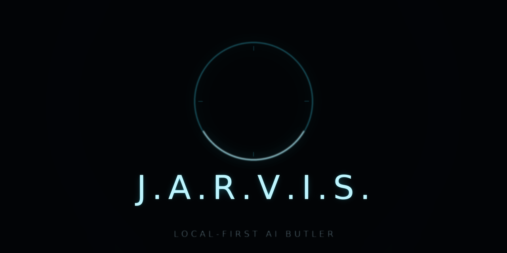

<p align="center">
  
</p>

# 🤖 Jarvis — a local-first assistant with a 3D galaxy brain

**Talk to your notes. Watch him fly to the answer. Keep everything on your machine — or don't, your choice.**

Jarvis is a 3D "knowledge galaxy" of your markdown notes with a dry-witted British butler attached. Ask a question and the camera dives to the note the answer came from. Say **"remember that…"** and a new star is born live. Switch his brain with your voice between **local (Ollama)** and **cloud (Claude / Gemini / ChatGPT / OpenRouter)**. Give him a cloned voice (VoiceStudio) and local ears (Whisper) — or let the browser cover for them, politely, until you do. And when you say so, he takes off the gloves: the **tool armory** gives him eyes for your screen, hands for your keyboard, a real browser to drive, and a forge where he learns new skills — each arm soft-fail, each one on command only. A **first-boot screen** lets you pick the agent and paste its key — no config files touched. And on command he raises the **holocam**: barehands, the hand-tracked air-board — notes, images and 3D models as glass cards over your camera feed, moved by pinching, throwing and clawing at the air with your bare hands.

> Built from the free prompt packs by **Zubair Trabzada · AI Workshop** ([Build Jarvis Fully Offline](https://youtu.be/OTb1DR47LSo) + *Give Your Jarvis X-Ray Vision*). This repo turns those packs into something anyone can clone and build — **without this repo ever downloading a model, an engine, or a big program for you.**


---

## ✨ What Jarvis does

| Capability | How it works | Needs internet? |
|---|---|---|
| 🌌 **3D galaxy of your notes** | `build.py` indexes every `.md` file into `viewer/graph-data.js`; nodes glow colour-coded by folder, links from title mentions and `[[wikilinks]]` | ❌ never |
| 🧠 **Answers only from YOUR notes** | top-6 keyword retrieval (title matches weighted 3×), then the current brain | ❌ local brain / ✅ cloud brain |
| 🎬 **The camera dive** | the answer flies the camera to its top source note and opens it — or lights the whole cluster when 4+ notes fed the answer. Small talk never moves the camera | ❌ |
| 🗣 **Cloned voice out** | VoiceStudio (local) speaks every answer in sentence-packed chunks; browser voice covers if the engine is down (and says so on the badge). A **VO** menu under the dial lets you cast the stand-in voice yourself — ranked butler-first, saved in your browser | ❌ |
| 💬 **The brain tells the truth** | a refused key, a wrong model id, an empty quota or a dead wire each get their own honest line, quoting the vendor's actual words, plus a red strip with an **OPEN SETUP** link under the answer | ✅ (the vendor's error call) |
| 👂 **Ears with a wake word** | Whisper hears "Jarvis, …", discards everything without the name, lets you say **"stop" / "wait"** mid-sentence. No Whisper? Chrome/Edge lend their own ears (0 MB); **Firefox/Zen have none — so the SERVER hears for you through Gemini** (free tier, one request per utterance) the moment a key is pasted | ❌ whisper / ✅ browser + gemini ears |
| ⭐ **Total recall** | say **"remember that…"** → a real markdown file is written, linked, and born in the galaxy with a glow pulse — no reload, no re-index | ❌ |
| 🔀 **Dual-mode brain shelf** | `switch to your local brain` / `switch to Claude` / ChatGPT / Gemini / OpenRouter — by voice or text, badge shows what's live | ❌ to switch ✅ to use cloud |
| 🧲 **The fallback chain** | the chosen brain fails — quota out, credits dry, key refused — and the answer STILL arrives: Jarvis quietly borrows the next usable brain (**Gemini free first**, then your local Ollama), a badge says `BRAIN gemini borrowed`, and the red strip keeps the vendor's own words. A 404/429 model also auto-heals to its `fallback_models` siblings (rate buckets are per model) | ✅ |
| ✋ **Hands on the files** | the brain stands ON your PC: "create a Minecraft mod folder and write the main file" really happens — it answers with `[[TOOL]]` blocks and the server executes them (read / write / list / make-dir / open), confined to your home shelf + this folder, `config.json`/`logs/`/`.git/` private forever, every deed a receipt on screen and in `logs/arms.log` | ❌ (stdlib, no gate needed for files) |
| 🛡 **The Wi-Fi-off drill** | `drill.py` proves a full turn (chat → voice → ears) touched nothing but localhost, and prints an honest list of what still needs the internet | ❌ (that's the point) |
| 🩺 **Preflight** | `preflight.py` runs 13 live checks against the running system and prints ticks and crosses | ❌ |
| 🦾 **The tool armory** | eyes (screen vision + a 24/7 watcher), hands (type/click/scroll/open + vision-guided pointing), a driven browser (search YouTube, open the second video), a scribe (files, PDFs, reports on your desktop), and a skills forge — see [the armory section](#-the-tool-armory--hands-on-command) | per arm, below |
| 🖐 **Barehands — the holocam** | a vendored copy of [jaredrhod/barehands](https://github.com/jaredrhod/barehands): your webcam becomes a hand-tracked board — pinch, throw, scale and "claw" notes, images and 3D models as glass cards; Jarvis boots it, opens it, mirrors his state onto its ring, and stages his last answer onto the glass on command | ❌ (browser fetches MediaPipe + three.js from CDN on first load) |
| 📓 **Memory that survives restarts** | every exchange lands in `memory/journal.jsonl` on your disk; at boot the butler walks back in with his recent conversations; "search my memory for X" reads the whole journal | ❌ |
| 🧭 **First-boot agent picker** | the first time you open Jarvis, a setup screen asks which agent he should think with and takes the API key in a password box — `config.json` is written **by the server**, never by hand; a TEST button knocks on the vendor's own models endpoint first; reopen it any time with the **AGENT** chip | ❌ (only the key's own test call, if you press TEST) |
| 🖱 **Desktop launcher** | one **DESKTOP** chip (or **ADD DESKTOP LAUNCHER** on the setup screen) and Jarvis drops a "Start Jarvis" launcher on your real desktop — a proper Windows shortcut with the cyan-ring icon, a `Jarvis.command` on the Mac, a `.desktop` entry on Linux. Next time is a double-click, no terminal | ❌ (writes one file, on your desktop, only when you ask) |
| 🔇 **Mute tabs** | any tab opened with `?mute=1` never makes a sound — used for testing, enforced inside the one `speak()` function | ❌ |

## 🖥 The look

Black space, a starfield, slow idle rotation. Glowing orbs colour-coded by folder, hub notes wearing floating labels. Left console: **search the brain**, instructions, **top hubs**, live **force sliders** (repel / link length). Right console: group legend with counts, the **J.A.R.V.I.S. dial** spinning faster while he listens or speaks, live state (STANDBY · LISTENING · THINKING · SPEAKING), MEM/LINKS meters, and real toggles — **EYES** (labels), **HOLO** (cinema mode), **FOCUS** (idle rotation), **REFLECT** (reset view), **ARMS** (the tool armory), **HOLOCAM** (raise barehands), **AGENT** (the setup screen), **DESKTOP** (the launcher on your desktop). Bottom: one command bar with a round mic button and the wake toggle.

## 🧠 The brain shelf (dual mode)

`config.json` holds a `brains` block. Each entry is one of two kinds:

| kind | Speaks to | Ships with |
|---|---|---|
| `anthropic` | the Claude Messages API | `claude` → `claude-opus-5-5` |
| `openai` | anything speaking the OpenAI chat-completions shape: **OpenAI/ChatGPT, Gemini's compatible endpoint, OpenRouter, Ollama, LM Studio, llama.cpp-server, vLLM** | `openai` · `gemini` · `openrouter` · `local` (Ollama) · `big` (your largest local tag) |

Add your own entry and Jarvis picks it up automatically — control tags, badge and voice routes all follow the shelf. Each brain may also carry `"fallback_models": ["sibling-id", …]` — tried in order when the main id 404s or 429s (Gemini's free-tier rate buckets are **per model**, so a crowded flash model has free siblings). Example, typed into **your** editor:

```json
"mistral": { "kind": "openai", "base_url": "https://api.mistral.ai/v1",
             "model": "mistral-large-latest", "api_key": "PASTE-YOURS" }
```

**Say it out loud (or type it):**

| You say | Jarvis does |
|---|---|
| "switch to your local brain" | badge: `BRAIN local qwen3.5:9b` |
| "switch to Claude" / "chat gpt" / "gemini" / "openrouter" | switches; if the key is still the placeholder he answers one dry line and stays local |
| "switch to your big brain" | your largest local model |
| "which brain are you on" | answers, in character |

Restarts always boot on `boot_brain`. A swap is runtime-only, exactly like the pack says.

**The fallback chain, in one breath:** when the *current* brain fails mid-question (quota, credits, dead key, silence), Jarvis does not hand you an error where an answer should be — he borrows the next usable brain (Gemini first: the free tier; then local; then the rest of the shelf), finishes the thought with it, and says so: the badge reads `BRAIN gemini borrowed - the usual brain stumbled`, and the red strip still quotes the original vendor's own words so you know what to fix.

## 🧭 The first-boot screen — pick your agent, paste your key

Open `http://127.0.0.1:4700` with no `config.json` and Jarvis hands you a
setup screen instead of the galaxy: every brain on the shelf as a card —
**Claude / ChatGPT / Gemini / OpenRouter** (cloud, 0 MB to install) and
**local / big** (Ollama, no key needed). Click one, paste the key into the
password box, optionally adjust the model id, press **TEST** (one knock on
that vendor's own models endpoint through `net.py`, logged like everything
else), then **SAVE & ENTER THE GALAXY** — `config.json` is written by the
server, the brain switches live, no restart. The key is never echoed back,
never logged, and `config.json` itself still 404s over HTTP. Reopen the
screen any time with the **AGENT** chip on the right console. Prefer to skip?

When a cloud brain misbehaves, Jarvis does **not** say a bare "unreachable": he quotes the vendor's own words — *"Gemini refuses the key, sir — he says: 'Please pass a valid API key'"*, *"There is no 'gemini-3.8-flash' on his shelf… his shelf carries, for instance: …"*, *"quota or billing"* — and the viewer adds a red strip with an **OPEN SETUP** link. Wrong model id? The setup screen's TEST button and the error line both list what the vendor actually carries. And since the fallback chain exists, the answer usually arrives anyway — borrowed, badged, with the diagnosis still on record. Every agent card now says what its key looks like (`AIza…` / `sk-or-…` / `sk-ant-…` / `sk-…`) so the right key lands in the right slot — the classic mix-up is pasting an AI Studio key into OpenRouter and concluding "he can't work with any API".
The *Skip* link enters with no key — he answers one dry line until you set a
real agent. The screen itself is a local page: **0 MB downloaded**.

## 🗣 What you can say

| Say this | Get this |
|---|---|
| "when do we open on Saturdays?" *(any note question)* | the answer + the camera flies to the note |
| "remember that the drill passed" | a new note file + a star born in the galaxy, confirmed out loud |
| "Jarvis, …" *(wake word on)* | hands-free; everything without the name is discarded locally |
| "stop" / "wait" *(while he speaks)* | instant silence |
| "use your browser voice" / "use your local voice" | voice preference flip, shown on the badge |
| "create a folder called mods and write a file called main.txt inside it" | the brain's `[[TOOL]]` blocks do it for real — folder made, file written, receipts badged |

## 🦾 The tool armory — hands, on command

Click **ARMS** on the right console (or ask *"what tools do you have"*). Ten arms, each one a soft bay that reports honestly when its dependency is missing:

| Arm | What it does | Needs |
|---|---|---|
| `web.fetch` | read any web page's text, on request | nothing — stdlib |
| `weather` | current weather anywhere (open-meteo, keyless) | nothing |
| `github` | read a repo or its open issues; your PAT optional (`arms.github_token`) | nothing |
| `eyes` | screenshot your screen and answer about it, **or watch it 24/7** — glance every N seconds, note only what changes, remember the last observations | a cloud brain key (Gemini/Claude/…) + `pip install mss pillow` |
| `hands` | type, click, scroll, press keys, open apps, **and aim by vision** — "click on the subscribe button" aims the cursor at what the brain sees | `pip install pyautogui` **and** the config gate |
| `browser` | drive a real Chromium like a person: "search for lofi on youtube" opens YouTube, types in YouTube's box, hits search — then "open the second video" clicks it | `pip install playwright` + `playwright install chromium` |
| `scribe` | make files, reports and **PDFs** on your desktop (`Desktop/Jarvis/`) | `pip install reportlab` for PDFs (markdown always works) |
| `files` | the brain's own file hands: read, write, list and open real files on your shelves via `[[TOOL]]` blocks — "create a Minecraft mod file" actually creates it | nothing — stdlib, always on |
| `skills` | forge new skills when he can't do something; you approve; then they run | nothing |
| `holocam` | **barehands**: raise the hand-tracked board on :8794, open it in your browser, mirror his state onto its ring, and put his last answer on the glass | nothing — vendored, stdlib; your browser fetches the tracking libs from CDN on first load |

**The words that move the arms:**

| Say | Jarvis does |
|---|---|
| "what do you see" / "see my screen" | screenshot → your vision brain → one dry description |
| "watch my screen" … "what happened on my screen" … "stop watching" | 24/7 eyes: glances every 15 s (configurable), notes only what changed, summarises on demand |
| "search for lofi on youtube" | opens YouTube, types in **YouTube's search box**, hits search — not Windows search, not the URL bar |
| "open the second video" / "open the third result" | clicks the exact result, tells you its title |
| "click on the subscribe button" | vision-guided aim: he looks, the brain returns the pixel, the hand clicks |
| "type hello and press enter" / "press ctrl+s" / "scroll down" | only after **hands on** |
| "open spotify" | your OS launches the app (hands gate applies) |
| "make a report on quarterly beans" / "make a pdf about roasting" | brain drafts it, `.md` + `.pdf` land in `Desktop/Jarvis/` |
| "make a file called shopping saying milk, eggs" | a real file, really written, path spoken back |
| "create a mods folder and write the mod's main file in it" / "read my notes/todo.md" / "open my Downloads folder" | the files arm: the brain answers with `[[TOOL]]` blocks, the server executes and the badge shows the receipts — no gate, no install, your home shelf only |
| "weather in cairo" / "fetch https://…" / "github repo owner/name" | keyless web arms |
| "make a skill that splits the bill" | he drafts a python file → **awaits your approval** |
| "barehands" / "holocam" / "open the holocam" | boots the barehands server on 127.0.0.1:8794 and opens the board in your browser — allow the camera and wave |
| "holocam status" / "is barehands running" / "close the holocam" | is it live, and strike it down |
| "put that on the board" | his last answer flies onto the glass, centre stage, spotlit |
| "approve skill splits-the-bill" → "run skill splits-the-bill 84 for 4" | armed skills run with a 20 s leash |
| "what did we talk about recently" / "search my memory for coffee" | the journal: everything ever said, on disk, across sessions |
| "hands off" | instant stand-down, even mid-task |

**Barehands — the holocam, specifically:** press the **HOLOCAM** toggle (or the RAISE THE HOLOCAM button in the armory panel, or just say *"barehands"* or *"holocam"*). Jarvis boots the vendored barehands server — pure stdlib Python on 127.0.0.1:8794, loopback only, no gate needed because it can touch nothing but itself — and opens the stage page. Allow the camera in Chrome and the ring wakes: tap it to bloom the orbs (**Notes** = the sample gestures course, **Galaxy** = your own notes folder, **Manual** = this project's docs, **Props** = the media airlock). While the stage is up, the ring mirrors Jarvis: thinking while he thinks, speaking while he talks. Gestures: tap opens, pinch-drag moves, hold-while-carrying rotates, two hands scale, flick throws, **clap** sweeps the board, and the **claw** rips a distant card across the room. First load only, your browser fetches Google MediaPipe and three.js from their public CDNs — that fetch is made by your browser, never by Jarvis's Python, and it is the page's only non-local call. barehands is © Jared Rhodenizer, AGPL-3.0-or-later, vendored intact under `barehands/` with its licence and docs.

**The safety rails, plainly:** hands ship **locked** — `pc_control.enabled` is `false` in `config.json`, the armory panel makes you confirm, and after that **"hands on"** is still required each session (set `pc_control.auto_hands_on: true` if you want the session arming automatic). Every hand action lands in `logs/arms.log` with what was typed or opened. The watcher only runs while **you asked** and stops on "stop watching"; it sends a frame to the brain **only when the screen actually changed**. Skills are drafted by your current brain, inspected by a static seatbelt (no subprocess, no sockets, no `os.system`, no `eval`, no reading `config.json`), and **nothing runs until you approve it**. The brain's file hands need no gate because they stay on a short leash by law: only your **home folder** and the Jarvis folder, `config.json` / `logs/` / `.git/` unreadable, writes capped at 1 MB, reads at 2 MB — and every deed leaves a receipt on screen and in the log. Eyes send screenshots to the *same brain your questions already use* — the one door in `net.py`, logged as always. Memory is a plain jsonl file on your disk — "wipe my memory" archives it rather than deleting. Reverse-engineering binaries is **not** built in, and skills deliberately cannot spawn tools like radare2; ask and he'll read what text can be read, honestly.

## 📤 Publishing to GitHub — even if you have never pushed

`push.bat` (Windows, double-click) / `push.sh` (Mac/Linux): run it **from inside the jarvis folder, next to `main.py`**. On first run it turns a freshly-unzipped folder into a git repository by itself (one clean commit — a zip never carries git history), adds the remote, pushes `main`, and prints your live repo URL. Type your username, and **git itself** asks for the password — paste a token from [github.com/settings/tokens](https://github.com/settings/tokens) there, **hidden input, on your machine**. It never enters a chat, and `config.json` is gitignored, so it can never be committed. If GitHub rejects you because the repo isn't empty, the script asks for the word **OVERWRITE** and replaces the remote with this folder; re-run it any time after changing files and it commits and pushes the update by itself. After the push it also **sets the About description and the 12 topics for you** (the `gh` CLI if you have it; otherwise one more hidden token prompt and two API calls — the token lives in memory for those and is gone). The only manual touch left is the **social preview** image — Settings → General → Social preview → upload `docs/banner.png` — the one setting GitHub's API refuses to let anyone automate. Alternatively drag-and-drop `jarvis-upload.zip`'s contents onto your repo page → *Add file → Upload files* — and make sure the GitHub repo was created **empty** (no README/.gitignore/license), or the push is rejected.

If you skipped the script's automatic dressing (or it couldn't reach the API), dress the repo page by hand (30 seconds): **Settings → General → Social preview** → upload `docs/banner.png`. **About ⚙️** → description: *"A local-first AI butler: your notes as a 3D star map, voice in and out, ears in any browser, file hands on your PC, a tool armory, a holocam — and a brain that borrows Gemini free when yours fails. Nothing downloads itself on boot. Ships with a 125-check offline test suite."* → topics: `jarvis` `ai-butler` `ai-assistant` `local-first` `knowledge-graph` `llm` `ollama` `whisper` `tts` `voice-assistant` `threejs` `python`.

## 📦 What gets downloaded — the honest table

**This repo never downloads a model, an engine, or a big program for you.** `setup.py` only copies a config, generates sample notes if you have none, verifies the ~1.8 MB of vendored viewer libraries, and builds the index. Everything big below is **installed by you**, on purpose, from its own official page.

| # | Thing | Who downloads it | Download | Takes on disk |
|---|---|---|---|---|
| 1 | **This repo** (`git clone` or the zip) | you | ~4 MB | ~7 MB (incl. 1.8 MB vendored viewer libs, the vendored barehands holocam, and sample notes) |
| 2 | **Python 3.9+** | you (maybe already installed) | ~25 MB installer | ~100 MB |
| 3 | **Ollama** — the local brain runtime | you, from [ollama.com/download](https://ollama.com/download) | ~0.6–1 GB installer | ~2–4 GB **before models** |
| 4 | **A brain model** — e.g. `ollama pull qwen3.5:9b` | you, one command | ~5–6 GB | same, in `~/.ollama` |
| 5 | **VoiceStudio** — the cloned-voice app + its TTS engine (VoxCPM2 on Windows/NVIDIA, mlx-audio on Mac) | you, from its project page | engine-dependent, typically ~0.5–2 GB | ~1–3 GB |
| 6 | **Whisper ears** *(optional — Chrome's own ears work with 0 MB; Firefox/Zen get the server's Gemini ears, also 0 MB)* | you, one command | ~130–200 MB pip packages | ~0.3 GB |
| 7 | **Whisper weights** — `large-v3-turbo` (default) + `small` (wake word) | **never on boot.** you, one explicit command: `python hear.py download` | ~1.6 GB + ~0.5 GB, announced before anything moves | same, in your model cache |

**Totals, honestly:** the Jarvis core itself is **~3 MB** and runs **today** with zero steps 3–7 — with no Whisper installed the mic is the **browser's own ears: 0 MB, works in Chrome/Edge immediately** (their speech recognition sends audio to the browser maker's cloud; that is the trade), and in **Firefox/Zen — which have no built-in ears at all — the server's Gemini ears take over** (free tier, one request per utterance, once a key is pasted; still 0 MB). Installing Whisper is the one thing that buys **no audio ever leaving the room**, and it costs the ~2 GB of weights in rows 6–7. The fully-local experience is roughly **8–14 GB** extra depending on the brain you pick. On your class of machine (16 GB RAM, 4 GB VRAM) a 7–9B model at 4-bit is the sweet spot; the `big` shelf is for when you buy more memory.

> 💡 Every engine is **optional and soft-fail**: no Ollama → cloud brain or a dry "no key" line; no VoiceStudio → browser voice + a badge; no Whisper → browser ears + a badge telling you exactly what to install. Jarvis always boots.

## 🚀 Quick start

```bash
git clone <this-repo> my-jarvis && cd my-jarvis
python setup.py            # creates config.json once, sample notes if needed, checks your engines
python main.py             # or double-click start.bat (Windows) / ./start.sh (Mac/Linux)
```

Open **http://127.0.0.1:4700** — click anywhere once (browsers block autoplay before that), hear *"Hello, sir."*, and ask something from your notes.

1. **No notes?** `setup.py` writes 30 realistic sample notes into `notes/` so the galaxy is alive on first boot. Point `notes_dir` in `config.json` at your own folder whenever you're ready.
2. **Keys:** copy the placeholder over with your real key in **your editor** (`config.json`). Never paste a key into any chat. `config.json` is gitignored and returns **404** if the browser ever asks for it.
3. **Local brain:** install Ollama yourself, `ollama pull <tag>`, set the tag on the `local` shelf entry. That's the whole ceremony.

## ⚙️ Connecting the three engines (details in [docs/engines.md](docs/engines.md))

| Engine | What it gives Jarvis | Install it | Jarvis connects via |
|---|---|---|---|
| 🧠 **Ollama** | a local brain that costs nothing per word | installer from ollama.com, then `ollama pull qwen3.5:9b` | `http://localhost:11434/v1` — the same OpenAI-shaped request the cloud brains use |
| 🎙 **VoiceStudio** | your cloned voice, spoken locally | the app, clone a profile named `Jarvis` (or set `voice.profile` to yours) | `http://127.0.0.1:3900` — OpenAI-style `/v1/audio/speech`, WAV, disk-cached |
| ☁️ **Cloud voice tier** *(automatic)* | a deep male voice (Gemini `Charon` / OpenAI `onyx`) with **zero installs** while VoiceStudio is closed | nothing — it borrows an agent key you already pasted | same `/tts` endpoint; falls through to the browser stand-in if no key |
| 👂 **Whisper** (faster-whisper / mlx-whisper) | local ears + the "Jarvis" wake word | `pip install faster-whisper` (Windows/Linux) or `pip install mlx-whisper` (Mac) | in-process (`hear.py`); weights load once at boot, warmed with 1 s of silence |

## 🧪 Proving it works (no GPU, no models needed)

```bash
python tests/mock_brain.py         # a tiny OpenAI-compatible brain on :11500
python tests/mock_voicestudio.py   # a tiny VoiceStudio on :3900
# point config.json's local brain at http://localhost:11500/v1, then:
python main.py                     # in another terminal
python tests/test_hear.py          # wake-word logic (+ real Whisper when installed)
python tests/test_hands_tools.py   # the hands law: path leash, private shelves, tool loop, fallback chain
python tests/test_arms.py          # 65 offline checks: gates, vision shapes, skills chain
python preflight.py                # 13 live checks against the running server
python drill.py                    # the Wi-Fi-off proof; ends with THE HONEST LIST
```

`drill.py` only runs when `boot_brain` is a local brain, sends a real question, speaks the answer, feeds audio back through `/hear`, audits **every outbound host** during the window (must be empty), and reads the browser's own resource-timing report. If a cloud brain with a real key is live, the drill **fails on purpose** and names the host — that's how you know the watcher works.

## 📁 Layout

```
main.py / setup.py / start.bat / start.sh   ← entry points (root, like the pack intends)
push.bat / push.sh  ← publish to your GitHub; the token is typed into git's own hidden prompt
config.template.json                        ← the brain shelf; copy → config.json, add keys
build.py          the indexer  (id == index, always)
server.py         the brain + persona + routes + the file hands + the fallback chain  (port 4700, loopback only)
voice.py / hear.py  the VoiceStudio bay / the ears bay (Whisper + the Gemini ears, soft-imported)
arms.py            the tool armory: eyes+watcher, hands+pointing, browser, scribe, files, skills, holocam
                   viewer/setup.html  the first-boot agent picker (pick brain, paste key, zero config editing)
memory.py          the journal: every exchange on disk, restored at boot
net.py            the ONE logged outbound door (logs/outbound.jsonl)
drill.py / preflight.py  the proof rituals
barehands/         the stage: jaredrhod/barehands vendored intact (AGPL-3.0) + its Jarvis config
viewer/           index.html + vendored three.js r149 + 3d-force-graph 1.73.5 (no CDN, ever)
notes/            your markdown, grouped by folder; captures/ is where memories are born
skills/           skills the butler forges live here after YOUR approval (gitignored)
tests/            mock brain, mock VoiceStudio, fixture WAVs, 10 offline suites (125 checks, incl. a live end-to-end pass over every route)
tools/            sample-note generator
docs/arms.md      the armory deep-dive: setup, safety rails, skill contract
docs/engines.md   per-engine install guide for Windows / Mac / Linux
```

## 🛡 The laws this build respects

- **One door out.** Every outbound byte the server sends goes through `net.py` and is logged with host + reason. The drill reads that log.
- **Hands stay gated.** PC control is `false` in config until *you* flip it, then *"hands on"* every session, and every action is logged. "Hands off" always wins.
- **The file hands stay on sir's shelves.** The brain's `[[TOOL]]` blocks reach only your home folder and the Jarvis folder; `config.json`, `logs/` and `.git/` are private forever; reads and writes are capped; every deed is a receipt.
- **No skill runs unapproved.** Draft → static seatbelt → your explicit approval → a 20-second leash.
- **Keys never reach the browser.** `config.json` 404s over HTTP; placeholder keys produce one dry line and are never served or spoken.
- **One `speak()`.** The `?mute=1` gate lives inside the single function that makes sound — nothing routes around it.
- **Never claim an action happened** without a receipt from the code. The one unforgivable sin, per the butler's own rules.
- **The camera belongs to the answer.** Small talk holds the galaxy still; only real note questions move it.
- **Vendored or nothing.** The 3D libraries are pinned in `viewer/vendor/VERSIONS.txt`; the page renders with the network off.
- **Nothing big downloads itself.** Boot never fetches a model — Chrome's ears (free, 0 MB) are the default; the offline Whisper weights land only when you run `python hear.py download`, announced and explicit.

*Known cosmetic note: the console may print "Multiple instances of Three.js being imported" — the pinned graph library bundles its own copy internally; rendering is unaffected.*

## 🧰 Troubleshooting

| Symptom | Meaning | Fix |
|---|---|---|
| badge says `VOICE browser (stand-in)` | VoiceStudio is closed **and** no cloud-voice key is set | open VoiceStudio (Install 02), or paste a Gemini/OpenAI key on the AGENT screen |
| badge says `EARS browser (0 MB, free)` | Chrome's ears are on duty — Whisper isn't installed, and nothing was downloaded | keep them (they work), or `pip install faster-whisper` for the offline ears |
| installed faster-whisper but the badge still says browser ears | the weights are not on disk — by design, boot never fetches them | `python hear.py status` to check, `python hear.py download` (~2.1 GB) to install — or keep Chrome's ears |
| "Claude has no key yet, sir." | placeholder still in `config.json` | type the key in your editor; never in a chat |
| red strip says `QUOTA · Your credit balance is too low…` and the badge says `BRAIN gemini borrowed` | OpenRouter (or another paid brain) ran out of credits — the fallback chain answered with Gemini | nothing to do right now: the answer arrived; top up credits or `switch to gemini` (free tier) |
| "he says he can't touch my files" | that was the old build — today's butler has file hands | just ask: "create a folder called X and write Y in it"; it works on your home shelf, and the badge shows the receipts |
| the mic is dead in Firefox / Zen | those browsers ship no speech recognition | paste a free Gemini key on the AGENT screen — the server's Gemini ears take the mic from there; or open in Chrome/Edge |
| answers are slow on the local brain | model too large for your RAM/VRAM | try a smaller tag on the `local` shelf; keep the big one on `big` |
| mic does nothing | browser needs permission | allow the mic for `127.0.0.1` (lock icon by the address bar); the status line names the exact problem; typing always works |

## 📋 The build-pack audit — every prompt, honestly

The man's pack is *Build Jarvis Fully Offline* (Zubair Trabzada). Here is the point-by-point ledger:

| Pack | What it asks for | Status in this repo |
|---|---|---|
| Install 01 | Ollama brain on `:11434`, OpenAI-shaped requests, `reasoning_effort: none` | ✅ the shelf goes further: Anthropic **and** OpenAI-shaped brains, runtime switching by voice |
| Install 02 | VoiceStudio on `:3900`, engine pin, profile by name, 600-char cap, disk cache, keep-warm, `X-Jarvis-Voice` | ✅ exactly, in `voice.py` — **plus** a cloud tier (Gemini Charon / OpenAI onyx) so the voice sounds right even before VoiceStudio is installed |
| Install 03 | Whisper `large-v3-turbo` + `small` wake model, loaded once, warmed with 1 s of silence | ✅ exactly, in `hear.py`. **One declared deviation, on purpose:** the pack bans browser speech recognition; this build makes **Chrome's own ears the default** (free, 0 MB, `hearing.allow_browser_stt: false` restores the pack's law). And a law of its own: **the weights never download themselves** — `python hear.py download` is the one explicit fetch, announced before anything moves |
| Prompt 01 | 3D galaxy, `build.py` indexer, wikilinks, 700-char excerpts, port 4700, cache-friendly prompt | ✅ plus the permission tree: the galaxy also shows the **folders and files** Jarvis may touch, hanging off a golden CORE |
| Prompt 02 | sentence-packed 170-char chunks, prefetch chunk n+1 while n plays, never cut mid-sentence | ✅ for the local voice — and the browser stand-in now speaks the whole answer in **one** pass so the web voices cannot pause between words |
| Prompt 03 | getUserMedia 16 kHz WAV, SILENCE_MS 700, FINISH_MS 900, wake word, interrupts, raised threshold while speaking | ✅ all of it, named constants at the top of `viewer/index.html` |
| Prompt 04 | lean butler persona under 300 words, stable prefix, control tags, boot greeting, honest receipts | ✅ the PERSONA block at the top of `server.py` |
| Prompt 05 | `/remember` → `captures/` file, live birth + pulse + fly, one door for new notes | ✅ server `capture_note` + viewer `addNote` |
| Prompt 06 | brain shelf, spoken switches, 5-second badge, vendored libraries, the Wi-Fi-off drill | ✅ `drill.py` + the net log; the drill's honest list prints what still needs the internet |

**Honest additions beyond the pack** (asked for in chat, not in the PDF): the first-boot agent/key screen, the PC-control arm, the skills forge, the persistent journal, the barehands holocam, and this audit itself.

## 📜 Credits & licence

Concept, persona and the six-prompt method: **Zubair Trabzada — AI Workshop**, from the free packs *Build Jarvis Fully Offline* and *Give Your Jarvis X-Ray Vision* (video: [youtube.com/watch?v=OTb1DR47LSo](https://youtu.be/OTb1DR47LSo)). This repo is an open implementation of those packs. MIT — see [LICENSE](LICENSE). The packs themselves remain the author's work; this repo simply honours them, laws included.

**The holocam** runs on [barehands](https://github.com/jaredrhod/barehands) by Jared Rhodenizer — hand tracking by Google MediaPipe (Apache 2.0), 3D by three.js (MIT), the whole board under **AGPL-3.0-or-later**, vendored with its licence intact in `barehands/LICENSE`. If you share your version of Jarvis, that folder stays open under the same terms — which, for a repo you are publishing anyway, costs you nothing.
